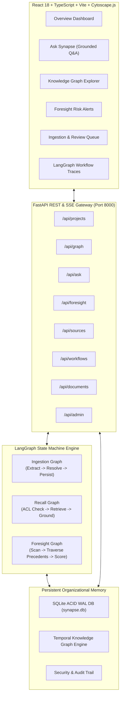

# SYNAPSE — Enterprise Organizational Memory Agent & Knowledge Graph

Production-quality, fully connected, live-demoable organizational intelligence platform by Artisan Systems.

SYNAPSE continuously ingests enterprise communications (emails, calendars, documents, RFCs, and incident post-mortems), maps that activity into an active temporal knowledge graph, and provides:
1. **Remember**: Document ingestion, chunking, entity extraction, relation mapping, and human-in-the-loop entity resolution.
2. **Recall**: Permission-aware hybrid Q&A strictly grounded in verified citations with graph traversal paths.
3. **Foresee (Foresight)**: Proactive risk detection that compares in-flight decisions against historical failure precedents and knowledge silos.

---

## Architecture Overview



---

## Quickstart Guide

### 1. Prerequisites
- Python 3.12+
- Node.js 18+ and `npm`

### 2. Environment Configuration
Copy `.env.example` to `.env`:
```bash
cp .env.example .env
```

### 3. Run Backend & Seed Database
From the project root:
```powershell
# Run the seed command (deterministic & idempotent)
python -m backend.services.seed_data

# Start the FastAPI backend server (Port 8000)
python -m uvicorn backend.main:app --host 127.0.0.1 --port 8000 --reload
```

### 4. Run Frontend
In a separate terminal:
```powershell
# Start Vite development server (Port 3000)
npm run dev
```

Open `http://localhost:3000/#dashboard` in your browser.

---

## Running the Automated Test Suite

Run the end-to-end integration and workflow test suite:
```powershell
python -m unittest backend/tests/test_backend.py -v
```

All 6 automated tests verify:
1. `test_01_seed_data_idempotency`: Multi-run database seed stability.
2. `test_02_graph_engine_neighborhood_and_paths`: Ego-network and multi-hop path traversal.
3. `test_03_temporal_validity`: Time-window queries (`validFrom`, `validTo`) filtering superseded decisions.
4. `test_04_langgraph_ingestion_workflow`: Document chunking, NER extraction, and knowledge persistence.
5. `test_05_langgraph_ask_workflow`: Grounded Q&A with verifiable citations and traversal paths.
6. `test_06_langgraph_foresight_workflow`: Precedent causal chains and risk alert scoring.

---

## 12 Verified Capabilities

| # | Capability | Status | Implementation Details |
|---|---|---|---|
| 1 | **Upload / Ingest Documents** | Verified | Live ingestion tab on Sources page via `/api/documents/ingest` and `/api/documents/upload`. |
| 2 | **Process & Persist Metadata** | Verified | Document normalization, text segmentation, chunking in SQLite `documents` and `document_chunks`. |
| 3 | **Extract Entities & Relations** | Verified | Rule-based and semantic NER extracting `Person`, `Project`, `Decision`, `Problem`, `Outcome`, `Topic`, `Team`. |
| 4 | **Store & Query Temporal Info** | Verified | `validFrom` and `validTo` tracking, bi-temporal point-in-time graph queries. |
| 5 | **Interactive Knowledge Graph** | Verified | Cytoscape.js rendering real nodes and edges, ego-network neighborhood queries, type filtering. |
| 6 | **Ask SYNAPSE Grounded Answers** | Verified | LangGraph `ask_workflow` returning citations (`[Doc-RFC419]`, `[Doc-882]`) and graph paths. |
| 7 | **Real LangGraph Workflows** | Verified | Three compiled `StateGraph` workflows with typed states, checkpointers, and step-level traces. |
| 8 | **Foresight Precedent Alerts** | Verified | LangGraph `foresight_workflow` detecting split-brain risks and knowledge silos with similarity scores. |
| 9 | **Navigate Causal Evidence Chains** | Verified | Multi-hop proofs connecting decisions to historical post-mortems and raw source files. |
| 10 | **Persistent State & History** | Verified | SQLite ACID storage with WAL mode, foreign keys, indexes, and full audit logs. |
| 11 | **Execution Progress & Traces** | Verified | Real step latencies, checkpointer state (threadId, stepCount), and trace logging. |
| 12 | **Repeatable Demo Mode** | Verified | `seed_database(force=False)` seeds Artisan Systems' Project Atlas & Incident 882 scenario idempotently. |
